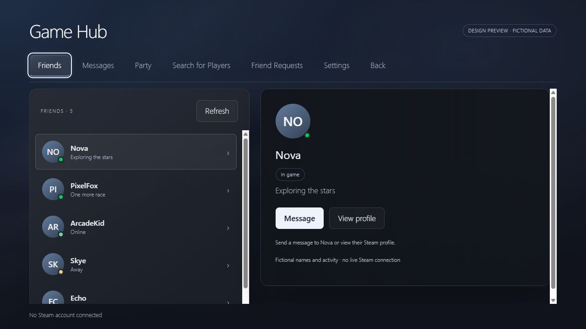

# Game Hub

PS5-inspired Home, Welcome widgets, Library, Control Center, Game News, Friends, Messages and Party for Steam Big Picture with Decky Loader. Includes controller navigation, media shortcuts and optional integration adapters.

**Experimental Windows-first pre-release. Not affiliated with Sony, Valve or Decky.** No game artwork, music packs, account data or game saves are distributed.

## Preview

Screenshot of the included browser preview, not a live Steam account. Home uses each user's own Steam artwork.

## Download

Open [Releases](https://github.com/toto-console/game-hub/releases) and download **Game-Hub-0.13.0-dev.46-decky.zip** from the newest pre-release. The automatic GitHub “Source code” archives are **not installable plugins**. Compare the file's SHA-256 with `SHA256SUMS.txt` from the same release.

## Platform status

| Environment | Status |
| --- | --- |
| Windows 11 x64, Steam Big Picture, existing Windows Decky setup | Development environment; plugin load checked locally. Full controller, gameplay and update recovery acceptance remain user testing. |
| Windows 10 | Not tested. |
| SteamOS (LCD / OLED) and Bazzite | Experimental source compatibility only. No device or installation validation. Not supported as verified platforms. |

Core backend paths use Decky's directory variables. Store/Friend Activity presentation checks the existing local CEF connection on either platform; XInput controller battery collection remains Windows-only. ThemeDeck's current bridge is Windows/version-specific and remains unavailable elsewhere. Linux has no Windows helper installer. This release does not supply or install Decky itself.

## Windows installation

1. Use an existing working Windows Decky installation in Steam Big Picture. Windows loader forks/builds differ; this is not a universal Windows installer.
2. Finish games, calls and downloads. Back up the existing `game-base-social` plugin folder and its Decky settings folder outside the plugin directory.
3. In Decky Settings, enable its developer controls if needed, choose **Install Plugin from ZIP**, select the **-decky.zip** asset and review Decky's confirmation. Keep the package's `game-base-social/` directory intact.
4. Reload Game Hub through Decky. If the backend requires a restart, restart Steam only when idle. Open Game Hub settings and enable the Home integration if desired. Avoid running another Home replacement simultaneously.
5. If your Windows Decky build does not support local ZIP installation, use that loader's documented installation procedure; do not run Linux shell installation commands on Windows.

Optional plugins are not required for startup. Audio Loader sound packs and ThemeDeck tracks must be supplied separately. Existing customized ThemeDeck bridges are not installed or modified by this package. Native Steam voice/network failures are not repaired by Game Hub.

## Updates and rollback

Software Update settings provide stable/beta channels (choose **Beta** for these development releases), startup and six-hour checks, manual checks, changelog, backups and verified downloads. Only matching platform/Decky metadata offers a package. SHA-256 checks detect corrupt or incomplete downloads; HTTPS and the pinned repository establish the source. Hashes are not independent signatures against a compromised repository.

**Automatic installation is disabled.** Verified downloads never replace the installed plugin. Finish games, calls and downloads, then install the staged ZIP through Decky's normal confirmation. Settings are kept separately and are not included in the release ZIP. No Steam restart is performed automatically.

Use **Back Up Current Version and Settings** before manual updates. The UI shows the recovery location under Decky's Game Hub runtime directory (`updates/backup-VERSION/`). Keep both `rollback.zip` and `settings-backup.zip`; each version's first backup is retained. If Game Hub cannot load, open Decky independently and install `rollback.zip`. To restore matching configuration, close Steam/Decky and restore only the files under `settings/` from the settings backup into Game Hub's own Decky settings directory. Never extract it into other plugins. Steam browser-local preferences remain in Steam's existing profile; do not clear Steam browser data. Back these up separately if resetting that profile. Manual installs have no reliable success acknowledgment, so the UI does not fabricate a “last successful update”.

## Development and releases

Node 22, Python 3.11+, `npm ci`, `npm run build`, `npm test`, then `python -m unittest discover -s tests -p 'test_*.py'` and `python scripts/package-public.py`. The source archive contains build inputs and notices, not node_modules or private previews.

CI validates pull requests and main. The release workflow requires a deliberate **Run workflow** with a version tag and `publish=true`, then repeats mandatory validation before publishing assets. For this first release all versions are pre-releases. Compatibility metadata is maintained in `release-compatibility.json`; do not add environments without evidence. There is no official Decky Store listing yet; submission requires the upstream plugin database review process.

See [CHANGELOG](CHANGELOG.md), [release notes](RELEASE-NOTES.md), [updater validation](UPDATE-VALIDATION.md), and [third-party notices](THIRD-PARTY-NOTICES.md). Report failures with version, OS, Decky version and reproduction steps in [Issues](https://github.com/toto-console/game-hub/issues). Remove account IDs, tokens and private messages from logs before sharing.

## License and visuals

Original code: MIT. Derived PS5 Dashboard code retains its upstream MIT notice; other licenses are listed in THIRD-PARTY-NOTICES.md. Artwork is fetched from Steam at runtime. Public preview images, when supplied, use synthetic sample data; personal screenshots and copyrighted game images are excluded from this release.

## Steam Deck / Bazzite loading failures

Use the named **Game-Hub-VERSION-decky.zip** release asset, not GitHub's automatic **Source code (zip)** download. The automatic source download is not a built plugin. Older named `-source.zip` assets also lacked `dist/index.js`; from dev.47 onward the named source package includes the matching compiled interface as a safeguard.

“Failed to fetch dynamically imported module” means Decky could not load the plugin module; it does not by itself prove a SteamUI API mismatch. Confirm the installed plugin has `dist/index.js`, record Game Hub/Decky/Steam versions and the full failed URL, and inspect Decky's log for the corresponding request. Do not delete settings or reset Steam data. Reinstall the named `-decky.zip` through Decky and restart Steam when idle if the failed module remains cached. If it persists, submit the full error and versions. Linux is still experimental; see [device test checklist](docs/LINUX-TESTING.md).
